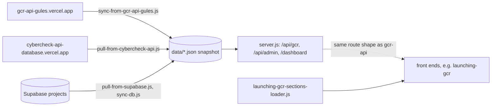

# gar-front-end-data

A snapshot of about 9,000 Gulf Coast business records plus a small JSON-file API and admin page that serve them.

## What it is

A data export with a thin Express server on top (package name `gcr-front-end-data`, described as "JSON-backed, no database"). The businesses (name, address, phone, hours, photos, menus, ratings) are committed as JSON files, and about 40 one-off scripts in the repo root pulled, merged and de-duplicated them from the other Gulf Coast Radar APIs and Supabase projects. `DEPLOYMENT-STATUS.md` still says 5,580 entities were synced; the repo actually holds 8,985 entity files, so that note is out of date.

## How it works

- `server.js` (Express, port 3001 by default, deployable on Vercel via `vercel.json`) mounts `routes/gcr.js` at `/api/gcr` and `routes/admin.js` at `/api/admin` (also `/api/businesses`), serves `data/` statically at `/data`, and serves `dashboard.html` at `/dashboard`.
- Read routes in `routes/gcr.js`: `/sections`, `/entities`, `/entity/:slug`, `/events`, `/specials`, `/happy-hours`, `/settings/:key`, `POST /search`, `POST /track`, and per-entity `/entity/:slug/{menu,hours,photos,offers,info,about,amenities}`. Write routes (PATCH, POST, DELETE on entities and `/api/admin/businesses`) write straight to the local JSON files, which will not persist on Vercel's read-only file system.
- Data in `data/`: `entities/*.json` (8,985 files), `entities-index.json`, `events.json`, `specials.json`, `happy-hours.json`, `sections.json`, `launching-gcr-sections.json`, `settings.json`.
- Sync scripts in the root: `sync-from-gcr-api-gules.js` (pulls from `https://gcr-api-gules.vercel.app`), `pull-from-cybercheck-api.js` and `batch-fetch-entities.js` (from `https://cybercheck-api-database.vercel.app`), `pull-from-supabase.js` and `sync-db.js` (from Supabase projects), plus consolidate, mega-merge and dedupe scripts. `launching-gcr-sections-loader.js` feeds section config to the `launching-gcr` front end.
- `node_modules/` is committed.

## Run it

```
npm start        # node server.js, http://localhost:3001
npm run dev      # node --watch server.js
npm run sync     # node sync.js (needs network access to the source APIs)
```

Env var names: `PORT`, `GCR_WRITE_KEY` (guards the write routes), and `SUPABASE_URL` / `SUPABASE_KEY` for `sync-db.js`. Other sync scripts have their source URLs and credentials set in the script itself. I did not start the server while writing this.

## Status

Asset dump: a one-commit data snapshot and a JSON-file API that the Supabase-backed APIs have superseded; its lasting value is the exported dataset.

## Where it fits



## Related repos

- Data copy of what `gcr-api`, `gcr-api-clean` and the `gcr-api-gules` deployment serve; its `/api/gcr/entities` and `/entity/:slug` routes mimic `gcr-api`, so front ends such as `gcr-tripswipe` could point at it.
- Feeds the `launching-gcr` front end (per the last commit message; that repo was not checked here).
- Overlaps with the import scripts and `data-imports/` in `gcr-api-v2`.
